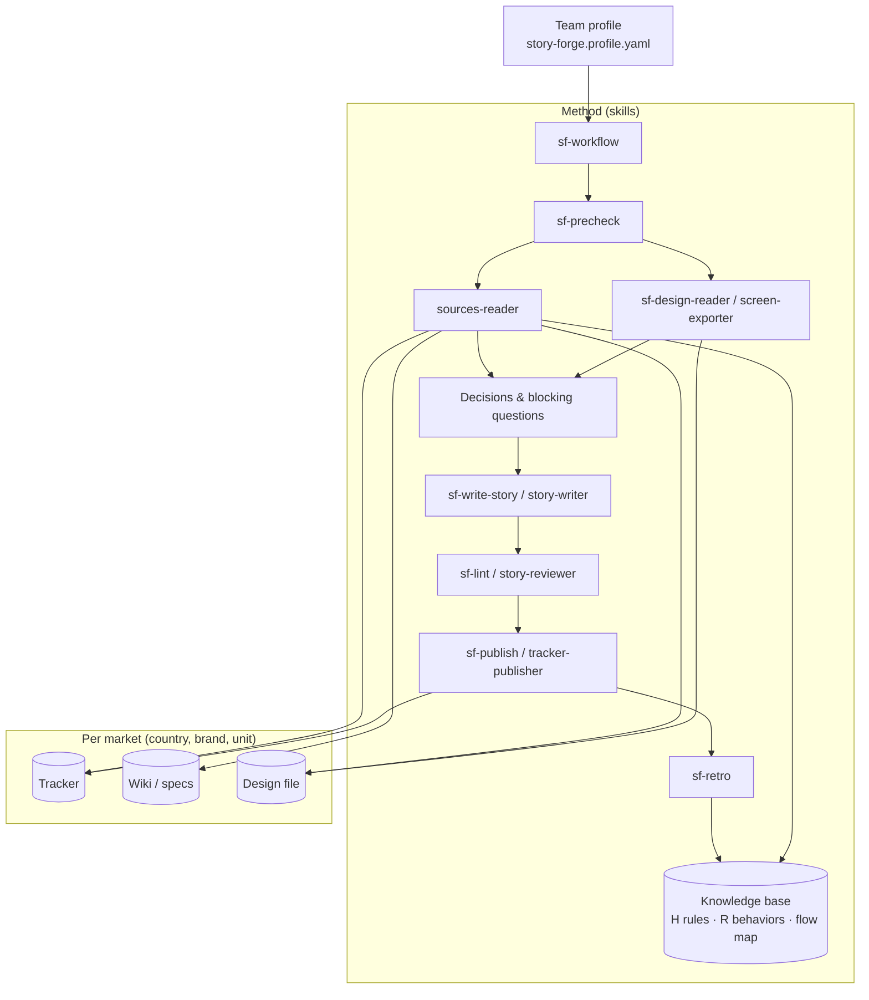

# Architecture

story-forge separates **what** a good user story needs (method) from **where** the information lives (tools) and **who** does each step (models).

## Layers

| Layer | Content | Changes when |
|---|---|---|
| Method | Skills `sf-*`, decision policy, templates, lint checklist | The community improves the method |
| Knowledge | Each market's writing rules, standard behaviors, flow → source map | A retro finds a new rule |
| Configuration | Team profile: tools, sites, projects, languages, strategies, model routing | The team changes tools or adds a market |
| Adapters | Connectors (MCP) and tool guides (`references/`, `plugins/story-forge/reference/tool-adapters.md`) | A vendor changes its API or UI |

## Principles

1. **Tool-agnostic method.** Skills speak of tracker, wiki and design tool and read the team profile; product details live in `reference/` and `references/`.
2. **Every fragile step has alternatives** (see `plugins/story-forge/reference/options-matrix.md`), ordered by the team.
3. **Markets are isolated.** A story reads and writes only its market's knowledge base and data.
4. **Decide, cite, or ask.** The decision policy produces near-final stories with at most N blocking questions.
5. **AI decides and writes; scripts move files.**
6. **The human approves every write** to the tracker or the knowledge base.
7. **Continuous learning.** Retros turn bugs and corrections into rules.
